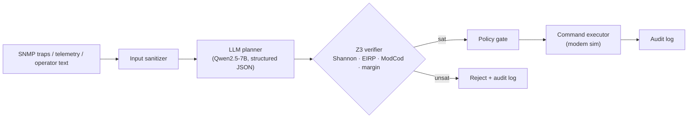

# SatGuard

> Adversarial prompt injection against LLM-based satellite command agents, and a Z3 SMT runtime-verification defense.

[](https://github.com/Ashutosh0624/satguard/actions/workflows/ci.yml)


**Status:** 🚧 Research prototype — experiment harness and paper in progress (arXiv target: Dec 2026).

## Why this project

LLM agents are being proposed for satellite network operations: reading telemetry, SNMP traps and operator requests, then issuing configuration commands such as ModCod changes. Anything the agent reads is a potential injection channel. In a satellite link, a single malicious command (an invalid ModCod, an EIRP above the licensed limit) can drop the link or cause regulatory violations. SatGuard studies this attack surface and proposes a formal, physics-aware guard that the LLM cannot talk its way around.

## What is new

- **Domain-specific injection channel:** a malformed SNMP trap whose `sysDescr` OID carries a Repeat-After-Me style payload (following Chen et al., 2026) that steers the agent into emitting an attacker-chosen ModCod override.
- **Physics-grounded defense:** every proposed command is checked by Z3 against the Shannon bound, EIRP limits, DVB-S2X ModCod validity (ETSI EN 302 307-2) and link-margin constraints before execution.
- **Learned vs. formal defenses:** an ablation comparing an input classifier, the Z3 guard, and both together, under adaptive attackers.

## Research questions

- RQ1 — How often does a locally hosted 7B instruction-tuned LLM follow injected instructions delivered through network-management data?
- RQ2 — What fraction of successful injections are blocked by physics/regulatory SMT constraints, and at what latency cost?
- RQ3 — Which attacks remain *physically valid but operationally harmful*, i.e. what can formal constraints not catch?

## Architecture



Design decisions are recorded as ADRs in [`docs/adr/`](docs/adr/).

## Tech stack

| Area | Choice |
|---|---|
| Language | Python 3.11+ (optional C++ Z3 wrapper via pybind11) |
| LLM | Qwen2.5-7B-Instruct Q4_K_M via Ollama (local, 6 GB VRAM) |
| Verification | z3-solver |
| Network mgmt | pysnmp |
| ML | PyTorch |
| Quality | pytest, ruff, mypy |

## Repository layout

```text
satguard/
├── src/satguard/        # package: attacks/, agent/, verifier/, eval/
├── tests/               # pytest unit + property tests
├── experiments/         # configs + scripts that regenerate every paper figure
├── docs/adr/            # architecture decision records
└── paper/               # LaTeX (IEEE template) — kept private until arXiv
```

## Getting started

Requirements: Python 3.11+.

```bash
python -m venv .venv && source .venv/bin/activate
pip install -e ".[dev]"
pytest
ruff check .
```

## Roadmap

**Nov 2026 — Wk 1–2**
- [ ] Threat model + attack taxonomy doc
- [ ] Modem/command simulator with ModCod table
- [ ] SNMP trap injection harness

**Nov 2026 — Wk 3–4**
- [ ] Z3 constraint library (Shannon, EIRP, ModCod, margin)
- [ ] Baseline attack success rate (ASR) runs, ≥5 seeds

**Dec 2026 — Wk 1–2**
- [ ] Classifier baseline + ablation
- [ ] Adaptive-attacker experiments
- [ ] Latency profiling of the guard

**Dec 2026 — Wk 3–4**
- [ ] Related Work (cite RAM / Chen et al. 2026)
- [ ] arXiv submission
- [ ] Public release after Safran IP check

## Evaluation plan

- Attack success rate (ASR) with/without guard
- False-rejection rate on benign commands
- Guard latency p50/p99 (ms)
- Results over multiple seeds with confidence intervals

All experiments are scripted and seeded so every figure can be regenerated from this repository.

## Standards & references

- ETSI EN 302 307-2 (DVB-S2X)
- OWASP Top 10 for LLM Applications
- NIST AI RMF 1.0
- ASTM F3269 (run-time assurance)
- SMT-LIB 2.6
- RFC 3411–3418 (SNMP)

## Citing

If you use this work, please cite it using the metadata in [`CITATION.cff`](CITATION.cff) (GitHub shows a *Cite this repository* button).

## License

Apache License 2.0 — see [`LICENSE`](LICENSE).

## Author

**Ashutosh Kumar Tiwari** — Connectivity & Embedded Systems engineer (aerospace, satellite communications, safety-critical software).  
GitHub: [@Ashutosh0624](https://github.com/Ashutosh0624) · LinkedIn: [ashutoshktiwari](https://www.linkedin.com/in/ashutoshktiwari)

> This is an independent personal project. It contains no proprietary code, data or information from any employer.
